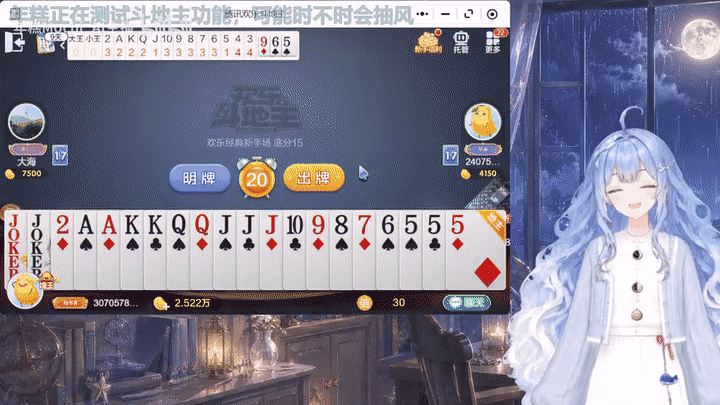

# AI 主播欢乐斗地主（Windows 微信小程序）

**让 AI 主播真正打一局斗地主，而不只是生成评论。**

实时识别微信小程序牌局，完成本地规则决策与 DeepSeek 有限改选，执行自动出牌与回读验证，并输出与真实动作、执行状态一致的口播事件。

本项目不是单纯的策略库或口播生成器，而是可供 AI 主播接入的**游戏执行层**；主播项目负责人设、TTS、弹幕和直播编排。



[观看完整实机视频（B 站）](https://www.bilibili.com/video/BV1DPyRzPEVq/)

> 非官方项目，与腾讯、微信及《欢乐斗地主》运营方无关。仅供技术学习和研究，请遵守游戏规则、服务条款及适用法律。

## 它和普通斗地主 AI 有什么区别

- **真实执行**：不是只回答“应该出什么”，而是识别真实牌局，完成选牌、出牌和结果验证。
- **口播与行动一致**：决策、口播素材和执行回执相互关联，避免主播说的牌和实际打出的牌不一致。
- **便于主播项目复用**：识别、决策和出牌由本项目负责，AI 主播只需消费事件并负责人设、语音和直播互动。

## 核心能力

- 手牌、桌面出牌、按钮、徽章和结算画面识别。
- 本地合法牌型枚举与正式推荐，DeepSeek 只在限定候选中改选。
- 分批选牌、自动点击、出牌回读、失败重试和取消托管。
- 输出决策、口播素材和执行回执事件。
- 人工接管、未知页面停手、充值及视频返豆保护。
- 离线自检和公开脱敏测试样本。

## 工作流程

```text
窗口截图与牌局识别
→ 本地规则生成正式推荐和候选
→ DeepSeek 有限改选并生成中性口播素材
→ 自动选牌、出牌与执行回读
→ 输出决策事件、口播素材和执行回执
```

| 层 | 主要文件 | 负责什么 |
| --- | --- | --- |
| 视觉与执行 | `mini_perceive.py`、`mini_bot.py` | 截图、认牌、选牌、点击和回读验证 |
| 本地规则与正式推荐 | `vendor/dsh-doudizhu/src/rules.js`、`bot.js` | 枚举合法牌型，由 `chooseAction` 给出正式推荐 |
| 有限改选与中性素材 | `mini_bot.py`、`model_decision.py` | 从“正式推荐＋最多两个备选”中改选并生成口播素材 |

本地引擎负责合法性、速度和基本牌技，DeepSeek 仍参与改选和表达。API 异常时有本地执行兜底，但不等于完整的离线 AI 主播。

## 快速开始

### 1. 准备环境

- Windows 10/11。
- 电脑版微信中的《腾讯欢乐斗地主》**小程序**，不是手机投屏或 QQ 游戏大厅。
- Python 3.13（验证版本 3.13.16）。
- Node.js（验证版本 24.14.0），不需要 `npm install`。
- 自己的 OpenAI 兼容 API，默认示例为 DeepSeek。

窗口尺寸、DPI 和首次兼容性要求见 [Windows、截图与 DPI](docs/windows-and-dpi.md)。

### 2. 安装依赖

在项目目录执行 PowerShell：

```powershell
py -3.13 -m venv .venv
.venv\Scripts\python.exe -m pip install -r requirements.txt -c constraints.txt
```

`constraints.txt` 固定 `onnxruntime==1.31.1`，安装时请保留 `-c constraints.txt`。

### 3. 配置 API

```powershell
Copy-Item api_config.example.json api_config.json
Copy-Item .env.example .env
```

在本机 `.env` 中填写自己的密钥：

```dotenv
DOUDIZHU_API_KEY=replace_with_your_key
```

`.env` 和 `api_config.json` 已被 Git 忽略，不要提交或公开。DeepSeek 请求有网络依赖和 API 费用。

### 4. 运行离线自检

```powershell
.venv\Scripts\python.exe mini_selftest.py
```

当前为 **276 项自检、0 失败**，另附 52 张脱敏测试图片。上游规则和策略测试为 **38/38 通过**。

**离线自检通过不代表当前电脑已经完成实机兼容验证。** 验证范围见 [验证记录](docs/verification.md)。

### 5. 人工观察一局

保持游戏窗口可见、稳定、不最小化，首次只运行一局：

```powershell
.venv\Scripts\python.exe mini_bot.py --seconds 900 --method message --interval 0.2 --hands 1
```

首次运行必须人工观察叫牌、选牌和点击位置。发现异常按 `Ctrl + Alt + P` 暂停；不要直接连续开局或无人值守。

### 6. 消费主播事件

| 输出 | 用途 |
| --- | --- |
| `outputs/decision_events.jsonl` | 完整决策、口播素材、执行回执和结算事件流 |
| `outputs/streamer_latest.json` | 最新一条可播报素材，适合轮询 |

```python
from streamer_events import follow_events

for event in follow_events():
    if not event.get('speak'):
        continue
    text = persona_rewrite(event['utterance'], event)
    tts.speak(text)
```

`persona_rewrite` 和 `tts` 由主播项目提供。**`decision` 不等于执行成功**，需要确认实际结果时继续消费 `execution_result`。本项目不内置人设、TTS、弹幕或直播平台接入。

完整接口说明见 [主播接入文档](docs/integration.md)。

## 已验证环境与限制

| 范围 | 当前状态 |
| --- | --- |
| 实机环境 | Windows 11、125% 缩放/DPI 120，客户区覆盖 933×620、1017×627、1031×641、1035×645 |
| 历史样本 | 另覆盖 933×580；公开样本均已脱敏 |
| 尚未验证 | 多显示器、其他 DPI、其他微信版本和皮肤 |
| 不包含的主播端能力 | 人设系统、TTS、弹幕、直播平台接入由主播项目负责 |
| 识别与策略边界 | 多张桌面牌仍可能误识别；不能保证牌力、胜率或无人值守稳定性 |

## 安全与隐私

- 不认识的页面不点击；购买、充值和“免费视频返豆”停手。
- 窗口变小、光标未到位或前台校验失败时放弃点击。
- 出牌失败只做有限重试；按 `Ctrl + Alt + P` 可暂停并完全手动接管。
- 不上传真实对局截图、日志、昵称、UID、房间号、密钥或其他个人信息；新增样本必须脱敏。

## 文档导航

| 文档 | 内容 |
| --- | --- |
| [主播接入](docs/integration.md) | 文件事件接口、事件字段、执行状态、持续开局和完整示例 |
| [识别与策略](docs/recognition.md) | OCR 回退、模板、计数、拆炸逻辑和候选规则 |
| [Windows、截图与 DPI](docs/windows-and-dpi.md) | 客户区、坐标、窗口移动、DPI 和截图保护 |
| [排查指南](docs/troubleshooting.md) | 日志、常见异常、点击保护和项目目录 |
| [验证记录](docs/verification.md) | 真实验证环境、实测范围和测试命令 |
| [更新记录](CHANGELOG.md) | 公开版本变化 |

## 许可证

本项目以 **MIT License** 发布，完整条款见根目录 `LICENSE`，按“现状”提供，不作担保。

本地规则和电脑玩家来自 [`dingchenhui0618-arch/dsh-doudizhu`](https://github.com/dingchenhui0618-arch/dsh-doudizhu)，对应包版本 `0.2.5`，固定在提交 `ed23ffca3b9b50da3c3b4bfd256bb0194ca72545`，许可证为 MIT。完整引擎已打包在 `vendor/dsh-doudizhu/`，保留其 `LICENSE` 和 `THIRD_PARTY_NOTICES.md`。上游规则还包含 Aevi 家庭斗地主的 MIT 授权声明。第三方组件分别遵循各自许可证；来源和本地改动登记见 `vendor/SOURCES.json`。
